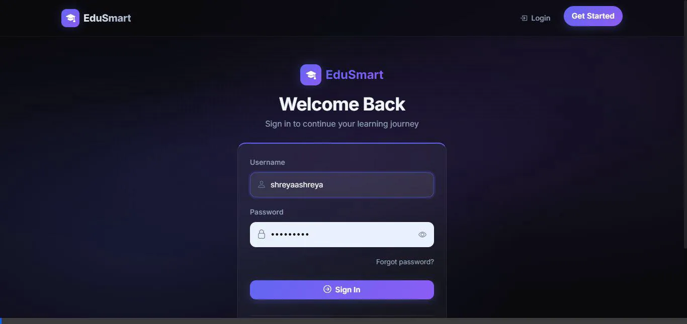
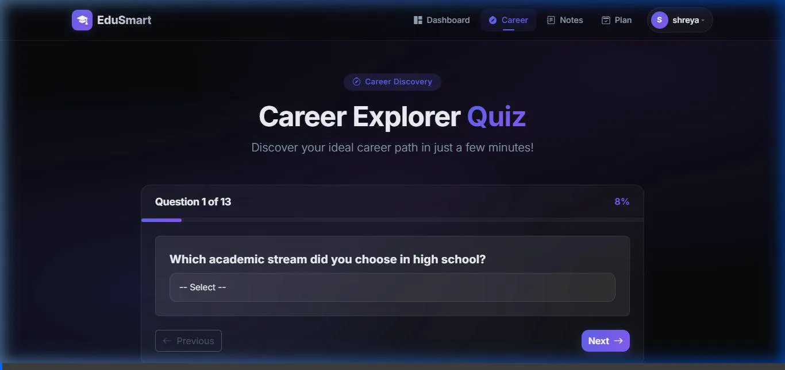
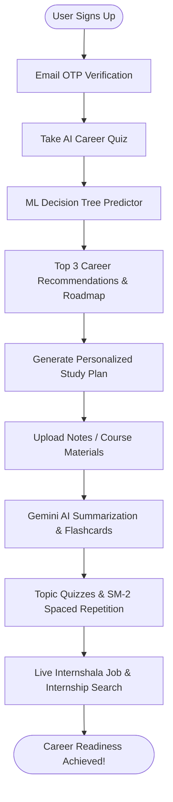

<div align="center">

# 🎓 EduSmart

**An end-to-end, AI-powered career discovery, personalized study planning, and skill development ecosystem.**

[](https://www.djangoproject.com/)
[](https://react.dev/)
[](https://www.python.org/)
[](https://ai.google.dev/)
[](https://scikit-learn.org/)
[](LICENSE)

<br />



</div>

---

## 🌟 Executive Overview

**EduSmart** is a full-stack, intelligent educational and career guidance platform designed to bridge the gap between student aspiration and industry readiness. By combining **Machine Learning (scikit-learn)** for career predictions, **Generative AI (Google Gemini)** for personalized curriculum and study materials, and **real-time job market aggregation**, EduSmart provides users with a tailored, actionable roadmap to professional success.

---

## 📸 Platform Highlights

<div align="center">
  
</div>

---

## 🚀 Key Features

### 🔒 1. Secure Authentication & Profile Management
* **Dual-layer Verification**: User registration with secure email OTP verification to prevent fake registrations.
* **Token-based Auth**: Custom token authentication for seamless REST API interactions.
* **Account Recovery**: Automated email-based password reset workflows with secure reset tokens.
* **Profile Customization**: Avatar image uploads, personal details management, and persistent progress tracking.

### 🧠 2. ML-Driven Career Assessment Quiz
* **Intelligent Evaluation**: Multi-step career assessment analyzing user skills, interests, academic background, and work preferences.
* **Scikit-Learn ML Engine**: Powered by a pre-trained `DecisionTreeClassifier` (`crud/ml/career_model.py`) delivering top 3 recommended careers with confidence scores and salary insights.
* **Dynamic Roadmaps**: Generates progressive 3–5 year career roadmaps complete with required skills, milestone certifications, and job market roles.

### 📚 3. AI Note Processing & Content Summarization
* **Document Extraction**: Support for `.pdf` and `.docx` study materials with automatic text extraction and normalization.
* **Gemini Generative Summaries**: AI-driven breakdown of complex topics into concise 500-word summaries, key takeaway bullet points, and estimated reading times.

### 🗂️ 4. Spaced Repetition Flashcards (SM-2 Algorithm)
* **Active Recall**: Automated flashcard generation derived directly from study summaries.
* **SM-2 Algorithm**: Implements the SuperMemo-2 spaced repetition algorithm (intervals, ease factors, repetition counts) adapting to user memory retention (Forgot / Hard / Medium / Easy).

### 📝 5. Adaptive Topic Quizzes & Assessments
* **On-Demand Generation**: AI generates multi-choice questions (MCQs) tailored to specific topic summaries with varying difficulty levels.
* **Instant Evaluation**: Real-time scoring, detailed explanations for wrong answers, and personalized recommendations for topics requiring review.

### 📅 6. Personalized Multi-Week Study Planner
* **Milestone Curriculum**: Generates structured, week-by-week study plans with daily tasks, recommended resources, and mastery quizzes.
* **Adaptive Learning**: Dynamic tracking of completed tasks with progress indicators and automatic difficulty adjustments.
* **Calendar Integration**: One-click **`.ics` Calendar Export** allowing students to sync their study milestones directly to Google Calendar, Apple Calendar, or Outlook.

### 💼 7. Live Job & Internship Aggregator
* **Real-time Scraper**: Integrated BeautifulSoup web scraper (`crud/scraper/intershala_scraper.py`) querying Internshala for active postings matching recommended career titles.
* **Resilient Architecture**: Automated fallback to curated mock data ensures uninterrupted user experience even during scraper blocks or network downtime.

### 📊 8. Interactive Analytics Dashboard
* **Data Visualization**: Rich visual charts built with **Recharts** (Bar, Line, and Pie charts).
* **Metrics Tracked**: Task completion percentage, study hours logged, topic quiz performance distribution, and platform leaderboards.

---

## 🛠️ Technology Stack

| Layer | Technology | Details |
|---|---|---|
| **Frontend** | React 19, React Router v7 | Modern single-page application with responsive layouts |
| **Styling** | Bootstrap 5, Custom CSS | Modern glassmorphism, responsive navigation, dark/light accents |
| **Visuals** | Recharts | Interactive SVG charts for dashboard metrics |
| **Backend API** | Django 5.2.3, Django REST Framework | Scalable RESTful endpoints, custom serializers, token authentication |
| **Database** | SQLite (Default) | Relational schema; easily swappable for PostgreSQL |
| **Generative AI**| Google Gemini API (`google-generativeai`) | Summarization, quiz generation, adaptive curriculum recommendations |
| **Machine Learning** | Scikit-learn, Joblib | Pre-trained decision tree classification for career mapping |
| **Scraper** | BeautifulSoup4, Requests | Web scraper targeting internship and entry-level listings |

---

## 📁 Repository Structure

```text
EduSmart/
├── crud/                           # Django Backend Project Root
│   ├── api/                        # Core Django Application
│   │   ├── admin.py                # Admin portal configurations
│   │   ├── apps.py                 # App configuration
│   │   ├── gemini_client.py        # Google Gemini AI client integration
│   │   ├── models.py               # Core database schemas (Profile, StudyPlan, Note, Quiz, etc.)
│   │   ├── roadmap.py              # Career roadmap engine & timelines
│   │   ├── serializers.py          # DRF Model & custom serializers
│   │   ├── signals.py              # User signals & post-save handlers
│   │   ├── urls.py                 # API routing endpoints
│   │   └── views.py                # Business logic & controller views
│   ├── crud/                       # Django Project Settings
│   │   ├── asgi.py                 # ASGI configuration
│   │   ├── settings.py             # Project settings (Auth, Email, Database, CORS)
│   │   ├── urls.py                 # Main URL routing & Media serving
│   │   └── wsgi.py                 # WSGI production server config
│   ├── ml/                         # Machine Learning Module
│   │   ├── career_model.pkl        # Serialized DecisionTreeClassifier model
│   │   ├── career_model.py         # Model training & inference logic
│   │   └── label_encoders.pkl      # Categorical feature encoders
│   ├── scraper/                    # Web Scraping Module
│   │   └── intershala_scraper.py   # Job & Internship scraper with fallback
│   ├── media/                      # User Uploads (Avatars, Notes, Documents)
│   ├── db.sqlite3                  # SQLite Database
│   ├── manage.py                   # Django Management CLI
│   └── .env                        # Local Environment Variables
├── frontend/                       # React 19 Frontend Application
│   ├── public/                     # Static files (index.html, icons)
│   ├── src/                        # React Application Source
│   │   ├── Api.js                  # Axios instance with auth interceptors
│   │   ├── App.js                  # App component & route definitions
│   │   ├── Navbar.js               # Global navigation bar
│   │   ├── Home.js                 # Landing page
│   │   ├── Login.js / Register.js  # Authentication pages
│   │   ├── Verify.js               # Email OTP verification
│   │   ├── Dashboard.js            # Analytics & charts dashboard
│   │   ├── StudyPlanPage.js        # Multi-week study planner & quiz modal
│   │   ├── NotesUpload.js          # File uploads, summaries & flashcards
│   │   ├── CareerQuiz.js           # Multi-step career questionnaire
│   │   ├── JobsPage.js             # Job & internship search directory
│   │   └── ProfilePage.js          # User profile & avatar management
│   └── package.json                # Frontend dependencies & scripts
├── requirements.txt                # Python backend dependencies
├── PROJECT_DOCUMENTATION.txt       # Detailed architectural and workflow reference
└── README.md                       # Master documentation
```

---

## ⚡ Quick Start & Installation

### 1️⃣ Prerequisites
* **Python**: 3.10+ installed
* **Node.js**: 18+ & **npm** installed
* **Google Gemini API Key**: [Get a Gemini API Key](https://aistudio.google.com/)

---

### 2️⃣ Backend Setup (Django)

1. **Navigate to the project root and activate virtual environment**:
   ```powershell
   # Windows PowerShell
   cd c:\Projects\new\EduSmart
   .\venv\Scripts\Activate.ps1

   # Linux / macOS
   source venv/bin/activate
   ```

2. **Install Python dependencies**:
   ```bash
   pip install -r requirements.txt
   ```

3. **Configure Environment Variables**:
   Create or verify `crud/.env` with the following variables:
   ```env
   # Security
   SECRET_KEY=your_django_secret_key_here
   DEBUG=True

   # AI Configuration
   GEMINI_API_KEY=your_gemini_api_key_here

   # Email Credentials (for OTP & Password Reset)
   EMAIL_HOST=smtp.gmail.com
   EMAIL_PORT=587
   EMAIL_USE_TLS=True
   EMAIL_HOST_USER=your_email@gmail.com
   EMAIL_HOST_PASSWORD=your_app_specific_password
   DEFAULT_FROM_EMAIL=EduSmart <noreply@edusmart.com>
   ```

4. **Apply database migrations**:
   ```bash
   python crud/manage.py migrate
   ```

5. **Create an administrator superuser** *(Optional)*:
   ```bash
   python crud/manage.py createsuperuser
   ```

6. **Start the Django development server**:
   ```bash
   python crud/manage.py runserver
   ```
   *The backend REST API will be available at `http://127.0.0.1:8000/`.*

---

### 3️⃣ Frontend Setup (React)

1. **Open a new terminal and navigate to the frontend directory**:
   ```bash
   cd c:\Projects\new\EduSmart\frontend
   ```

2. **Install Node.js packages**:
   ```bash
   npm install
   ```

3. **Start the React dev server**:
   ```bash
   npm start
   ```
   *The application will launch at `http://localhost:3000/` and automatically proxy API calls to port `8000`.*

---

## 📡 API Reference Overview

| Endpoint | Method | Description |
|---|---|---|
| `/api/auth/register/` | `POST` | Register a new user account & dispatch OTP |
| `/api/auth/verify-otp/` | `POST` | Validate 6-digit email OTP to verify profile |
| `/api/auth/login/` | `POST` | Authenticate user & return authorization token |
| `/api/auth/logout/` | `POST` | Invalidate current session/token |
| `/api/auth/forgot-password/` | `POST` | Request password reset email |
| `/api/auth/reset-password/` | `POST` | Reset password using verified token |
| `/api/profile/` | `GET`, `PUT` | Retrieve or update user details & avatar |
| `/api/career/quiz/` | `POST` | Submit career quiz & get ML recommendations |
| `/api/notes/upload/` | `POST` | Upload study document (`.pdf` / `.docx`) |
| `/api/notes/<id>/summary/` | `GET` | Retrieve AI-extracted topics and summaries |
| `/api/flashcards/` | `GET`, `POST` | Retrieve due cards or record SM-2 recall rating |
| `/api/study-plan/generate/` | `POST` | Generate customized multi-week study curriculum |
| `/api/study-plan/<id>/` | `GET`, `PUT` | Get study plan or toggle task completion state |
| `/api/study-plan/<id>/export-ics/` | `GET` | Download `.ics` calendar file for study plan |
| `/api/study-plan/topic-quiz/generate/` | `POST` | Generate real-time Gemini topic assessment quiz |
| `/api/jobs/search/` | `GET` | Fetch real-time scraped internship & job listings |
| `/api/dashboard/stats/` | `GET` | Get aggregated study hours, quiz scores, and analytics |

---

## 🔄 Core User Workflows



---

## 🧪 Testing & Verification

* **Backend Tests**:
  ```bash
  python crud/manage.py test api
  ```
* **Frontend Tests**:
  ```bash
  cd frontend
  npm test -- --watchAll=false
  ```

## 👨‍💻 Author & Development

* **Solo Project**: Conceptualized, designed, and engineered entirely by a **single developer** as a complete full-stack AI platform.

---

## 📄 License

This project is licensed under the **MIT License**. See the [LICENSE](LICENSE) file for more information.

<div align="center">
  <sub>Built with ❤️ by a solo developer. Empowering the next generation of career achievers.</sub>
</div>
cd